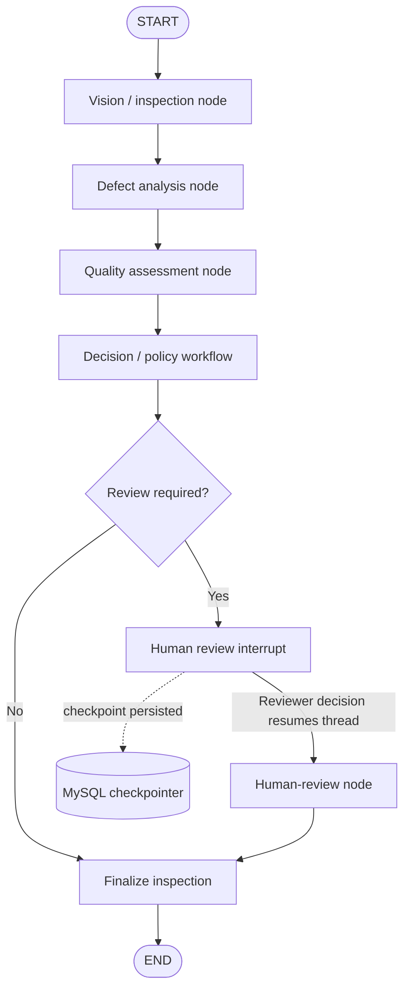
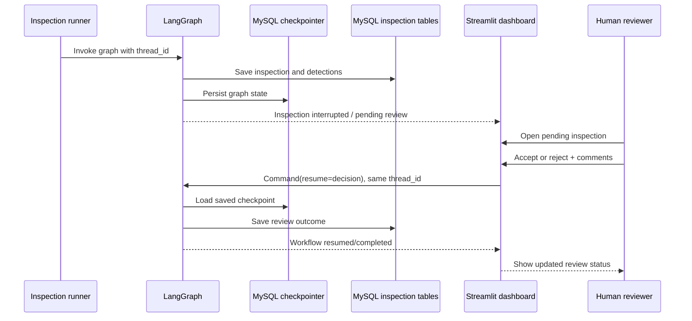

# 🚀 AreteVision

### Agentic Industrial Visual Inspection & Quality Intelligence

**From visual defect detection to traceable quality decisions.**

AreteVision is a computer-vision inspection system that orchestrates
defect analysis, quality assessment, policy-driven decisions, persistent
inspection records, and human review through a resumable LangGraph
workflow.

------------------------------------------------------------------------

## Table of Contents

-   [Project Overview](#project-overview)
-   [Problem Statement](#problem-statement)
-   [Core Features](#core-features)
-   [System Architecture](#system-architecture)
-   [LangGraph Architecture](#langgraph-architecture)
-   [End-to-End Inspection Lifecycle](#end-to-end-inspection-lifecycle)
-   [Human-in-the-Loop Workflow](#human-in-the-loop-workflow)
-   [Technology Stack](#technology-stack)
-   [Database Design and Persistence](#database-design-and-persistence)
-   [Project Structure](#project-structure)
-   [Setup and Installation](#setup-and-installation)
-   [Configuration](#configuration)
-   [Running AreteVision](#running-aretevision)
-   [Dashboard](#dashboard)
-   [Batch Processing and Duplicate
    Skipping](#batch-processing-and-duplicate-skipping)
-   [Key Engineering Decisions](#key-engineering-decisions)
-   [Limitations](#limitations)
-   [Potential Extensions](#potential-extensions)

------------------------------------------------------------------------

## Project Overview

Industrial visual inspection is often treated as a single model
prediction: an image enters a detector and a defect label comes out.
Real quality-control workflows need more than that. They need analysis
of detected defects, a quality decision, traceable inspection history,
and a mechanism for escalating uncertain or important cases to a human
reviewer.

**AreteVision connects these stages into an orchestrated inspection
workflow.** A YOLO-based computer-vision stage analyzes product images.
LangGraph coordinates downstream analysis and decision stages. MySQL
stores inspection records and detections, while a MySQL-backed LangGraph
checkpointer preserves execution state. A Streamlit dashboard exposes
inspection history and analytics and lets reviewers act on pending
inspections.

## Problem Statement

Manufacturing inspection systems need to do more than detect visible
defects. They must make inspection outcomes reviewable and traceable,
retain the context behind decisions, and support human intervention when
required.

AreteVision addresses this by combining:

-   Visual defect detection.
-   Multi-step workflow orchestration.
-   Quality assessment and decision routing.
-   Human-in-the-loop review.
-   Persistent inspection and detection records.
-   Resumable execution for workflows paused for review.
-   Dashboard-based monitoring and analytics.
-   Batch processing with path-based duplicate skipping.

## Core Features

### 1. YOLO-Based Visual Inspection

Uses a YOLO/Ultralytics detection pipeline to identify defects in
product images and produce detection information for later workflow
stages.

### 2. LangGraph Workflow Orchestration

Models inspection as a stateful workflow rather than a standalone
inference call. Workflow stages share a state object containing
information such as image path, thread ID, detections, inspection ID,
defect analysis, quality assessment, decision information, policy
decision, and pattern analysis.

### 3. Defect Analysis and Quality Assessment

Passes detection results through downstream analysis and assessment
stages so the workflow can produce a quality-oriented outcome rather
than stopping at raw bounding boxes.

### 4. Decision and Policy Workflow

Keeps decision-related output in the workflow state, allowing inspection
outcomes to be handled by the workflow's decision and policy logic.

### 5. Human-in-the-Loop (HITL) Review

Pauses an inspection when human review is required. The dashboard
displays pending cases and allows a reviewer to accept or reject the
inspection and add comments.

### 6. Persistent, Resumable Workflow Execution

Uses a MySQL-backed LangGraph checkpointer. Each inspection is
associated with a `thread_id`, allowing the dashboard to resume the
correct paused graph execution after a reviewer submits a decision.

### 7. Inspection History and Analytics

Stores inspection metadata and detection records in MySQL and exposes
summary information, defect analytics, trends, and human-review
analytics in the Streamlit dashboard.

### 8. Batch Inspection

Processes supported image formats from a directory. Before invoking the
graph, the batch runner checks whether the image path is already
recorded and skips it if it has already been inspected.

------------------------------------------------------------------------

## System Architecture

The following diagram shows how the main application components
interact.

``` mermaid
flowchart TD
    A[Product image / image directory] --> B[run_graph.py or run_batch.py]
    B --> C[LangGraph inspection graph]
    C --> D[YOLO / computer-vision inspection]
    D --> E[Defect analysis]
    E --> F[Quality assessment]
    F --> G[Decision and policy logic]
    G --> H{Human review required?}
    H -- No --> I[Inspection outcome]
    H -- Yes --> J[LangGraph interrupt / checkpoint]
    J --> K[Streamlit human-review dashboard]
    K --> L[Reviewer accepts or rejects]
    L --> M[Resume graph with Command(resume=...)]
    M --> N[Human-review node saves review]
    N --> I
    I --> O[(MySQL inspection records)]
    D --> O
    C <--> P[(MySQL LangGraph checkpoints)]
    O --> Q[Inspection history and analytics]
    Q --> K
```

**Component responsibilities**

  -----------------------------------------------------------------------
  Component                           Responsibility
  ----------------------------------- -----------------------------------
  `run_graph.py`                      Starts an individual inspection
                                      workflow.

  `run_batch.py`                      Finds supported images, skips
                                      already-recorded image paths, and
                                      invokes the graph for remaining
                                      images.

  `app/graph.py`                      Defines and compiles the LangGraph
                                      inspection workflow, including
                                      checkpointing and human-review
                                      behavior.

  `app/database.py`                   Provides MySQL connections and
                                      functions for inspection records,
                                      detections, review data, and
                                      related queries.

  MySQL business tables               Persist inspection metadata,
                                      detections, and human-review
                                      outcomes.

  MySQL checkpoint tables             Persist LangGraph state so an
                                      interrupted execution can be
                                      resumed.

  `dashboard.py`                      Displays inspection analytics and
                                      pending review cases; sends
                                      reviewer decisions back to the
                                      graph.
  -----------------------------------------------------------------------

------------------------------------------------------------------------

## LangGraph Architecture

LangGraph is the orchestration layer of AreteVision. It manages the
order in which inspection stages execute, passes data through a shared
state, and supports pausing and resuming an inspection when a human
decision is needed.

### Conceptual Graph Flow



This is a **logical overview** of the workflow, not a source-code
rendering of every conditional edge. The exact graph node names and
routing should be kept aligned with `app/graph.py`.

### Shared Graph State

The workflow carries information between stages in its state. The batch
runner initializes fields including:

  -----------------------------------------------------------------------
  State field                         Purpose
  ----------------------------------- -----------------------------------
  `image_path`                        Image being inspected.

  `thread_id`                         Unique identifier for the LangGraph
                                      execution thread.

  `inspection_id`                     Identifier for the persisted
                                      inspection record.

  `detections`                        Detection results produced by the
                                      vision stage.

  `inspection_history`                Inspection-history information used
                                      by the workflow.

  `defect_analysis`                   Output associated with defect
                                      analysis.

  `quality_assessment`                Output associated with quality
                                      assessment.

  `decision`                          Decision-related information.

  `policy_decision`                   Output from the policy/decision
                                      logic.

  `pattern_analysis`                  Output associated with pattern
                                      analysis.
  -----------------------------------------------------------------------

Individual nodes read relevant fields, perform their stage's work, and
update the state for downstream nodes.

### Graph Construction and Checkpointing

The graph is compiled with `PyMySQLSaver`, backed by a MySQL connection:

``` python
checkpoint_connection = get_checkpoint_connection()
checkpointer = PyMySQLSaver(checkpoint_connection)
checkpointer.setup()

graph = builder.compile(checkpointer=checkpointer)
```

This setup provides durable workflow checkpoints in MySQL rather than
relying on an in-memory checkpointer. It is important because a
human-review interrupt may outlive the original graph invocation or
application process.

### How Resume Works

1.  An inspection starts with a unique `thread_id`.
2.  The workflow executes using a graph configuration containing that
    thread ID.
3.  If human input is required, the graph interrupts and saves its
    checkpoint.
4.  The inspection record stores the matching thread ID.
5.  The dashboard retrieves that thread ID for the selected inspection.
6.  When the reviewer accepts or rejects, the dashboard resumes the same
    thread using a LangGraph `Command(resume=...)`.
7.  The human-review node records the review outcome in MySQL and the
    graph continues.

The crucial detail is that the dashboard resumes the **existing
thread**. It does not start an unrelated graph run for the review
action.

------------------------------------------------------------------------

## End-to-End Inspection Lifecycle

### Stage 1 --- Input

An individual image is passed to the graph, or a directory of images is
supplied to the batch runner.

### Stage 2 --- Visual Detection

The vision stage uses the configured YOLO model to analyze the image and
produce defect detections.

### Stage 3 --- Inspection Record

The workflow creates an inspection record in MySQL and associates it
with its `inspection_id`, image path, sample information, and LangGraph
`thread_id`.

### Stage 4 --- Defect Analysis

The workflow uses detection results in the defect-analysis stage and
makes the resulting analysis available in graph state.

### Stage 5 --- Quality Assessment

The workflow evaluates inspection information in the quality-assessment
stage.

### Stage 6 --- Decision and Policy

Decision-related and policy-related stages determine the workflow's
inspection outcome and whether further review is required.

### Stage 7 --- Human Review, When Required

The graph interrupts and persists its checkpoint. The inspection remains
available as pending review in the dashboard.

### Stage 8 --- Reviewer Action and Resume

A reviewer inspects the image and detection information, enters optional
comments, and selects **Accept** or **Reject**. The dashboard resumes
the saved thread, and the human-review node records the decision.

### Stage 9 --- History and Analytics

Inspection outcomes and review information remain available through
MySQL-backed dashboard queries.

------------------------------------------------------------------------

## Human-in-the-Loop Workflow

Human review is a workflow feature, not just a dashboard button.



### Reviewer Actions

-   Inspect the image and its recorded detections.
-   Review the inspection identifier and timestamp.
-   Add optional reviewer comments.
-   Accept or reject the inspection.
-   Resume the matching graph execution using its stored thread ID.

### Why Persistent Checkpointing Matters

Without a persistent checkpointer, the graph's paused state may not
survive an application restart. By pairing MySQL-backed checkpoints with
a thread ID stored in the inspection record, AreteVision can reconnect
the dashboard's review action to the correct paused execution.

------------------------------------------------------------------------

## Technology Stack

  -----------------------------------------------------------------------
  Technology                          Role in AreteVision
  ----------------------------------- -----------------------------------
  **Python**                          Core application and workflow
                                      logic.

  **YOLO / Ultralytics**              Visual defect detection.

  **LangGraph**                       Stateful graph orchestration,
                                      interrupt/resume behavior, and
                                      workflow checkpoints.

  **MySQL**                           Inspection history, detection
                                      records, review outcomes, and
                                      checkpoint persistence.

  **PyMySQL**                         Python connectivity used by the
                                      MySQL-backed
                                      application/checkpointer.

  **Streamlit**                       Interactive inspection and
                                      human-review dashboard.

  **Plotly**                          Interactive analytics and trend
                                      visualizations.
  -----------------------------------------------------------------------

------------------------------------------------------------------------

## Database Design and Persistence

AreteVision uses MySQL for both application data and LangGraph execution
state.

### Application Data

**`inspections`**

Stores inspection-level information, including identifiers, image path,
creation time, final action, review status, reviewer decision, comments,
review timestamp, and the LangGraph thread ID.

**`detections`**

Stores defect detections linked to their inspection, including class
name, confidence, and bounding-box coordinates.

### Workflow Persistence

The LangGraph MySQL checkpointer creates and manages its checkpoint
tables through `PyMySQLSaver.setup()`. These records preserve graph
state for interrupted and resumable executions.

### Data Flow

-   The vision stage writes the inspection record and its detections.
-   Dashboard analytics query the inspection and detection tables.
-   Human-review actions update the relevant inspection's review
    information.
-   The checkpointer persists graph state independently of the business
    inspection tables.

Keep the application tables and checkpoint tables conceptually distinct:
the former store inspection outcomes; the latter store execution state.

------------------------------------------------------------------------

## Project Structure

The following is the main structure referenced by the workflow.
Additional modules, model files, and configuration files may exist in
the repository.

``` text
AreteVision/
├── app/
│   ├── database.py       # MySQL connections, inspection records, detections,
│   │                     # review updates, and analytics queries
│   └── graph.py          # LangGraph workflow, nodes, interrupts, checkpointer
├── dashboard.py          # Streamlit analytics and human-review UI
├── run_graph.py          # Single inspection entry point
├── run_batch.py          # Batch runner and path-based duplicate skipping
├── .venv/                # Local virtual environment; should not be committed
└── README.md
```

------------------------------------------------------------------------

## Setup and Installation

### Prerequisites

-   Python 3.12, or the Python version supported by the project's
    dependencies.
-   MySQL Server.
-   The configured YOLO model weights.
-   Git.
-   The dataset or image directory to inspect.

### 1. Clone the repository

``` bash
git clone https://github.com/ViswaSekar-goat/AreteVision
cd AreteVision
```

Replace the placeholder with the actual repository URL.

### 2. Create and activate a virtual environment

``` bash
python3 -m venv .venv
source .venv/bin/activate
```

If a working environment already exists, activate it instead. On Ubuntu,
`python3` is commonly the system command used to create the environment.

### 3. Install dependencies

If the repository contains `requirements.txt`:

``` bash
pip install -r requirements.txt
```

Use the dependency manifest committed with the actual project. The
application needs its configured YOLO/Ultralytics, LangGraph, LangGraph
MySQL checkpoint integration, MySQL driver, Streamlit, and Plotly
dependencies.

### 4. Configure MySQL

1.  Start MySQL Server.
2.  Create the application database. The existing local setup used the
    database name `forgesight`; change the name only if the project
    configuration has also been updated.
3.  Create a MySQL user with appropriate permissions.
4.  Configure the connection used by `app/database.py`.
5.  Ensure the checkpointer connection points to the intended database.
6.  Never commit real database passwords or other secrets.

The checkpointer's `setup()` initializes its required checkpoint schema.
Application inspection tables must also be initialized using the
project's database setup.

### 5. Verify local paths and model weights

Check the YOLO weights path and image paths configured in the code.
Model weights and datasets are not necessarily included in Git because
they may be large or subject to separate dataset terms.

------------------------------------------------------------------------

## Running AreteVision

### Run one inspection

Activate the environment, then run:

``` bash
python run_graph.py
```

The runner starts an inspection graph execution with a thread ID. If the
workflow requests human review, open the dashboard to review the pending
inspection.

### Run batch inspection

The batch runner recursively discovers supported image files in the
specified directory, checks the database for an existing recorded path,
and invokes the graph for images that are not already recorded.

``` bash
python run_batch.py --folder /path/to/images
```

The current implementation's default folder is
`data/NEU-DET/train/images`.

**Duplicate-skipping detail:** The current check is based on the
recorded image path. It is not a perceptual or cryptographic
content-hash check; the same image copied to another path can be treated
as a new image.

### Launch the dashboard

In a second terminal:

``` bash
cd ~/AreteVision
source .venv/bin/activate
streamlit run dashboard.py
```

Open the local URL printed by Streamlit.

------------------------------------------------------------------------

## Dashboard

The Streamlit dashboard brings together inspection monitoring and human
review.

Its views include:

-   Inspection summary information.
-   Human-review status summary.
-   Defect analytics.
-   Inspection trends.
-   Human-review analytics.
-   Inspection history.
-   Pending-review cases with image and detection information.
-   Accept/reject controls and reviewer comments.

The dashboard uses database queries for inspection data and resumes
paused LangGraph executions through the stored thread ID.

> **Screenshot recommendation:** Add screenshots of the
> overview/analytics page and the pending-review interface here. Use
> real screenshots from the running application rather than illustrative
> mockups.

Example placement:

``` markdown


```

Create the `docs/images/` directory and add your screenshots before
enabling these image links.

------------------------------------------------------------------------

## Batch Processing and Duplicate Skipping

The batch runner:

1.  Searches the selected directory recursively for supported image
    extensions.
2.  Checks whether an image path is already present in the MySQL
    inspection records.
3.  Marks existing paths as **SKIPPED** rather than invoking the graph
    again.
4.  Invokes the graph for paths that are not yet recorded.
5.  Reports a summary of processed, pending-review, skipped, and failed
    items.

The duplicate check avoids repeated work when rerunning a batch against
the same paths. It does not guarantee duplicate detection for images
whose file contents match but whose paths differ.

------------------------------------------------------------------------

## Key Engineering Decisions

### Graph Orchestration Instead of a Single Prediction Call

The project separates visual inspection from downstream analysis,
assessment, decision-making, and review behavior.

### Interrupt-and-Resume Human Review

The reviewer interacts with a paused graph execution. The decision
resumes the same thread instead of starting a disconnected workflow.

### MySQL for Both Business Data and Checkpoints

Inspection history and detections are queryable as application records,
while graph checkpoints preserve execution state. Both are persistent
across application restarts when correctly configured.

### Thread ID Stored with the Inspection

The inspection record links a business-level inspection to the LangGraph
execution that produced it, enabling the dashboard to resume the right
workflow.

### Dashboard for Observability and Review

Inspection history, defect analytics, trends, and pending reviews are
exposed through one interface.

### Batch Duplicate-Path Skipping

Previously recorded image paths are skipped before graph invocation,
reducing unnecessary repeat processing.

------------------------------------------------------------------------

## Limitations

-   Duplicate detection is path-based, not based on image content.
-   Detection quality depends on the trained model, its classes, and the
    training data.
-   Human review only applies to cases routed to the review step.
-   Actual deployment readiness requires validation with representative
    production images, monitoring, and an appropriate quality-assurance
    process.
-   Setup commands and file paths must be verified against the current
    repository before another developer uses them.

## Potential Extensions

-   Content-hash-based duplicate detection.
-   Configurable quality thresholds and inspection policies.
-   Model performance reports and per-class evaluation metrics.
-   More detailed reviewer audit trails and role-based access.
-   Deployment packaging, logging, health checks, and monitoring.
-   Exportable inspection reports and integration with manufacturing
    systems.

## Security and Repository Hygiene

Before making the repository public:

-   Add `.venv/`, local environment files, secrets, and unnecessary
    generated data to `.gitignore`.
-   Never commit database passwords, API keys, or production
    credentials.
-   Use environment variables or a local configuration file excluded
    from Git for sensitive settings.
-   Provide a sanitized configuration example for contributors.
-   Document model-weight and dataset setup separately if the assets are
    not included in the repository.

## Author

**R Viswa**\
Computer Vision · Agentic AI · Intelligent Industrial Automation

------------------------------------------------------------------------

::: {align="center"}
**AreteVision --- An orchestrated, persistent, human-reviewable
inspection workflow.**
:::
